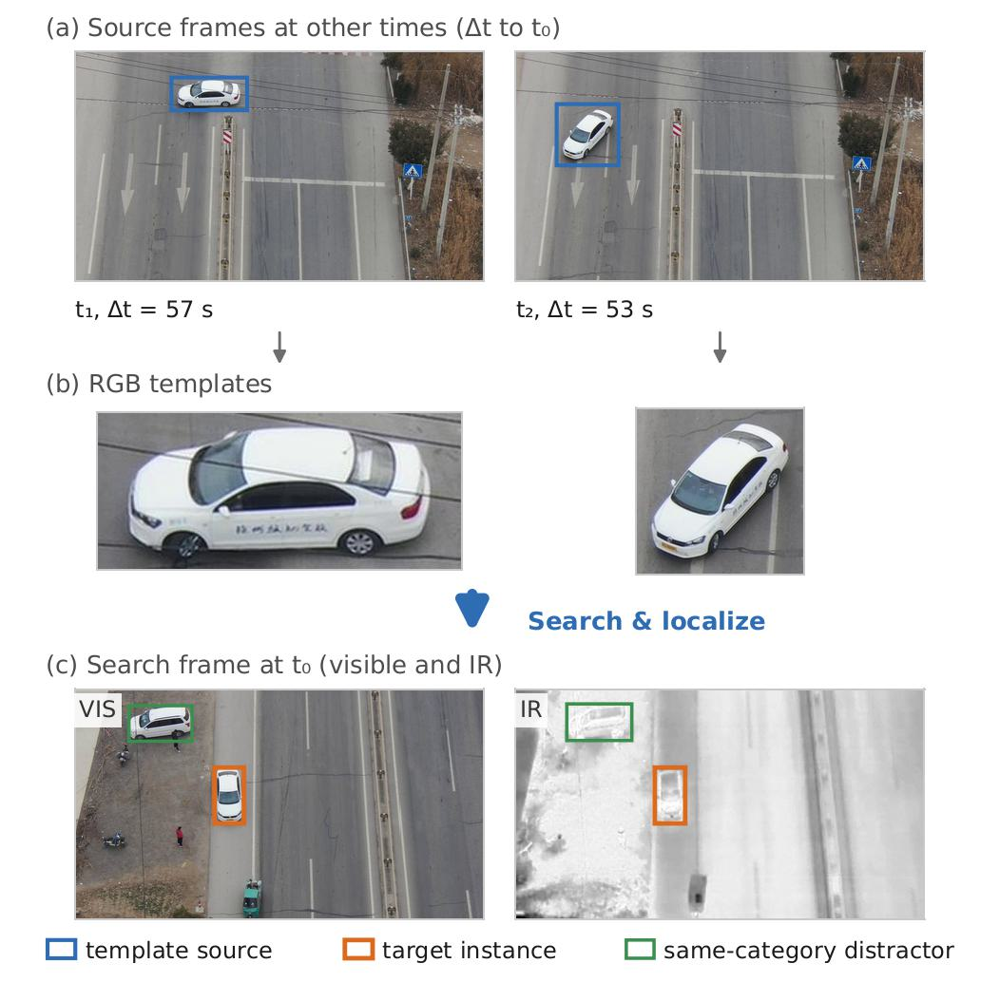
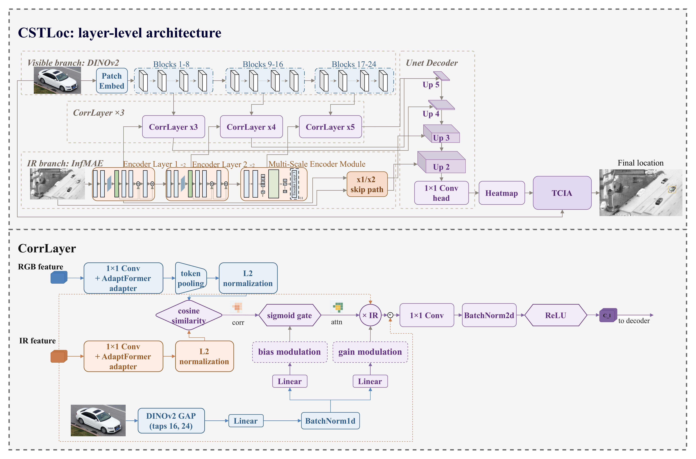
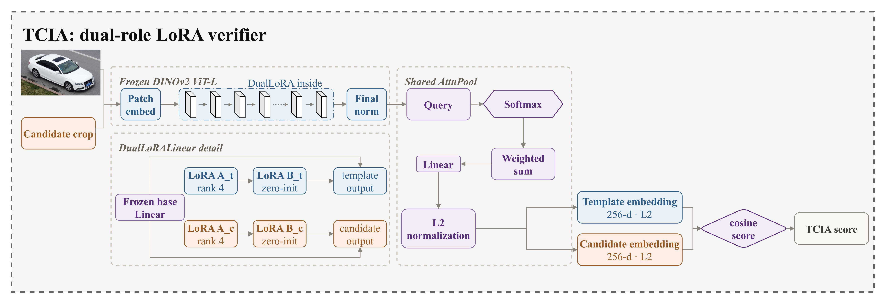
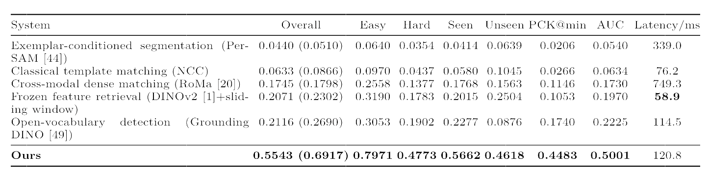

# CSTLoc: Adapting Vision Foundation Models for Cross-SpatioTemporal Instance Localization

**English** | [中文](README_zh.md)

**Cross-spatiotemporal visible-to-infrared instance localization.**
Given a visible-light (RGB) template slice of a target instance taken at one time and place,
localize that instance in an infrared (IR) scene captured at a different time — in the presence
of same-class distractors.



This repository contains the algorithm and training/evaluation code of the paper:

- **Frozen dual-backbone locator**: DINOv2 ViT-L (template) + InfMAE ViT-B (IR scene)
  → three-scale CorrLayer → UNet heatmap head → top-20 peaks;
- **TCIA identity adapter**: learns candidate-level identity embeddings on the top-20
  candidates with same-scene distractors and wrong-template contrast; cosine argmax
  re-ranks the candidates;
- the **CSTLoc benchmark** split and evaluation protocol (v3: 117 instances,
  327,772 test pairs) and five baseline adaptations.



## Environment setup

- Linux, Python 3.10, one CUDA GPU with ≥ 24 GB VRAM (developed on a single RTX 4090),
  ≥ 15 GB system RAM.

```bash
pip install torch==2.5.1 torchvision==0.20.1 --index-url https://download.pytorch.org/whl/cu121
pip install -r requirements.txt
```

### Pretrained backbones (download yourself)

The system starts from two public frozen backbones; they are **not** redistributed
in this repository.

- **DINOv2 ViT-L/14** (template tower + TCIA backbone): nothing to do — timm downloads
  `vit_large_patch14_dinov2.lvd142m` automatically on first use
  ([Hugging Face](https://huggingface.co/timm/vit_large_patch14_dinov2.lvd142m);
  official fallback <https://dl.fbaipublicfiles.com/dinov2/dinov2_vitl14/dinov2_vitl14_pretrain.pth>).
- **InfMAE ViT-B** (IR tower): download the official `infmae_vit_base_patch16`
  checkpoint from the InfMAE authors ("InfMAE: A Foundation Model in Infrared
  Modality", ECCV 2024; [official repo](https://github.com/liufangcen/InfMAE)) via
  [Baidu Netdisk](https://pan.baidu.com/s/1xofov5UWARRPVHB6586E2w?pwd=Apth)
  (extraction code `Apth`). Then place the file at `infmae/InfMAE.pth` (repo root)
  or `export CSTLOC_INFMAE_CKPT=/path/to/InfMAE.pth`.

> **License note**: the InfMAE code and checkpoints are released by their authors for
> **non-commercial research use only** (copyright: Chongqing University of Posts and
> Telecommunications). DINOv2 is released by Meta under Apache-2.0. Make sure your
> use of these backbones complies with their respective licenses.

### Dataset

The CSTLoc dataset:

| Item | Value |
|---|---|
| Instance directories | 117 (8 classes) |
| Raw split train / val / test | 70 / 23 / 24 |
| Usable instances (6 `rgb_usable=false` excluded) | 67 / 20 / 24 |
| Usable pairs | 614,221 / 171,587 / **327,772** |
| Template / scene frames | 7,407 / 9,933 |
| Total source footage | ≈ 5.83 hours |

The dataset is available on request before publication
(contact: yaochang_@nudt.edu.cn); a public download link will be added here after
acceptance. The archive is already organized into the official v3 train/val/test
split. Expected layout:

```
<CSTLOC_DATA_ROOT>/
  train/ val/ test/                 # per-instance directories
    <instance>/rgb/template/        # visible template slices (jpg + json)
    <instance>/ir/search/           # infrared scene frames (jpg + json)
```

## Reproduction

Every trainable weight is trained by you, starting from the public pretrained
backbones above. Set two environment variables first:

```bash
export PYTHON=/path/to/python            # python 3.10 with torch installed
export CSTLOC_DATA_ROOT=/path/to/CSTLoc  # dataset root
```

Then run the chain (single GPU; the steps run sequentially):

```bash
bash scripts/00_env_check.sh              # environment sanity check
bash scripts/01_prepare_dataset.sh        # dataset layout check
"$PYTHON" scripts/01b_build_test_cache.py # DINOv2 template-feature cache (from the dataset, ~1 min)
bash scripts/02_train_locator.sh          # train the locator      → weights/locator/best_model.pth
bash scripts/03_build_candidates.sh       # build 20k TCIA training candidates with your locator
bash scripts/04_train_tcia.sh             # train the TCIA adapter → weights/tcia/best_fullval.pt
bash scripts/05_eval_test.sh              # evaluate on the full v3 test split
bash scripts/06_reproduce_tables.sh       # compare your summary with the reported numbers
```

Or everything at once: `bash scripts/reproduce_all.sh`. Model selection uses the val
split only; the test split is touched solely by step 05.

## Repository layout

```
code/        models, training engine, losses, TCIA tools (see code/README.md)
scripts/     00–06 reproduction scripts + reproduce_all.sh
evaluation/  unified results aggregator
baselines/   five baseline adaptations (Grounding DINO, DINOv2 retrieval, RoMa, NCC, PerSAM)
```

## Baselines

`baselines/` contains one self-contained `run_cstloc.py` per method; each writes a
`results.jsonl` that `evaluation/aggregate.py` aggregates under the same protocol as
the main system. See [baselines/README.md](baselines/README.md).

## Reported results



## Citation & License

If you use this code or the CSTLoc benchmark, please cite the associated paper
(BibTeX will be added upon publication). Code is released under the
[MIT License](LICENSE). Thanks to the original DUT-VTUAV dataset
([official site](https://zhang-pengyu.github.io/DUT-VTUAV/)).
