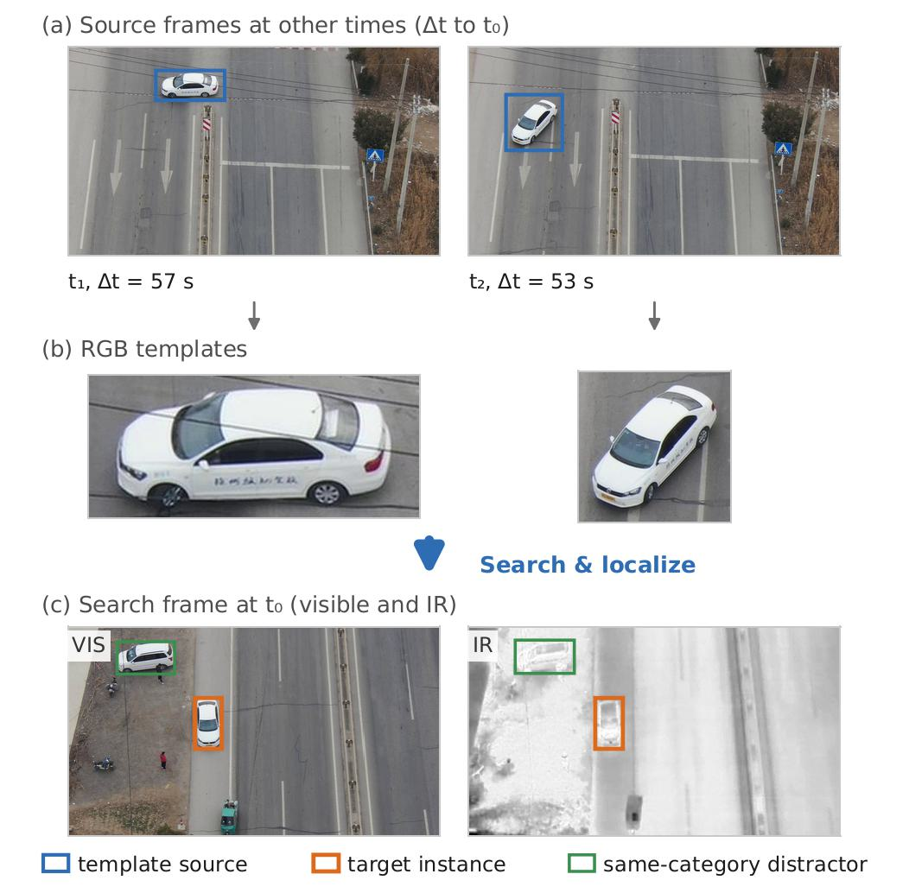
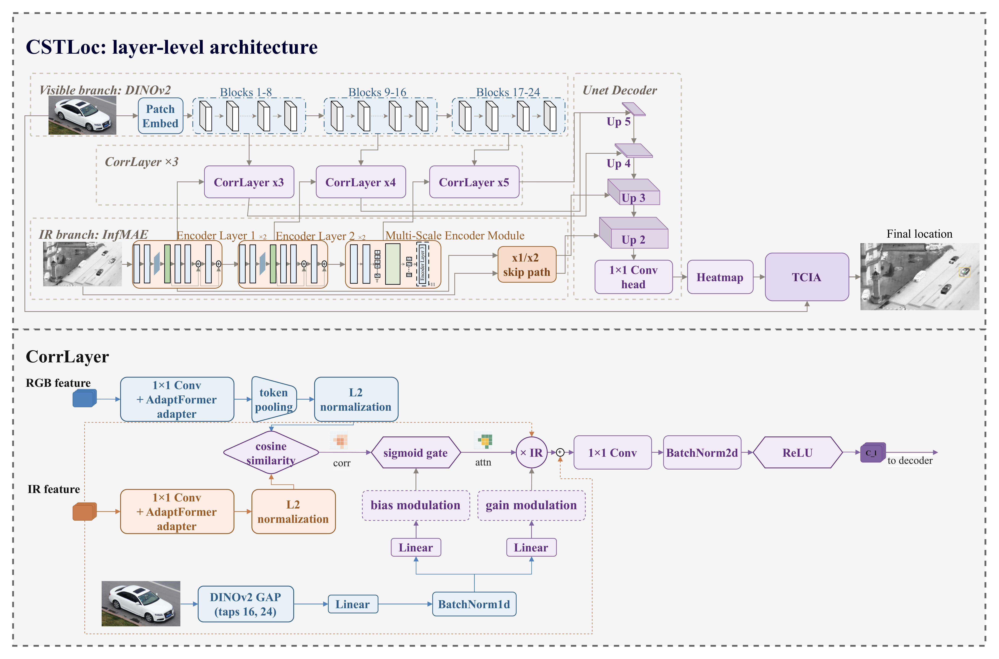
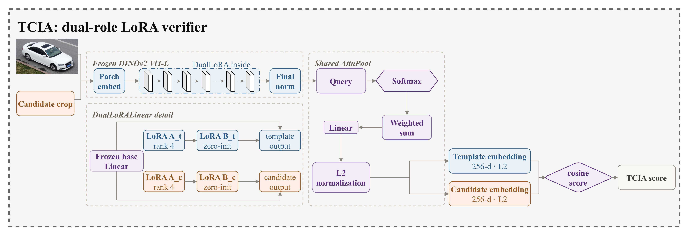
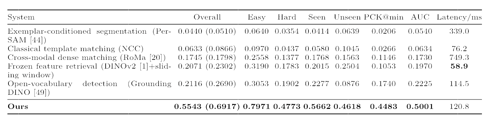

# CSTLoc: Adapting Vision Foundation Models for Cross-SpatioTemporal Instance Localization（中文说明）

[English](README.md) | **中文**

**跨时空可见光—红外实例级目标定位。** 给定目标实例在某一时刻的可见光（RGB）模板切片，
在另一时空获取的红外（IR）整帧场景中定位该实例；场景中可能存在多个同类干扰物。



本仓库包含论文的算法与训练/评测代码：

- **冻结双骨干定位器**：DINOv2 ViT-L（模板）+ InfMAE ViT-B（红外）→ 三尺度
  CorrLayer → UNet 热图头 → top-20 峰；
- **TCIA 身份适配器**：在 top-20 候选上学习候选级身份嵌入，用同场景同类干扰与
  错误模板对比训练，余弦 argmax 重排候选；
- **CSTLoc 基准** v3 划分与评测协议（117 实例，test 327,772 配对）与五个对照方法。



## 环境配置

- Linux，Python 3.10，单张 ≥24GB 显存的 CUDA GPU（开发机为 RTX 4090），内存 ≥15GB。

```bash
pip install torch==2.5.1 torchvision==0.20.1 --index-url https://download.pytorch.org/whl/cu121
pip install -r requirements.txt
```

### 预训练骨干（自行获取）

系统基于两个公开的冻结骨干；本仓库不再分发它们的权重。

- **DINOv2 ViT-L/14**（模板侧 + TCIA 骨干）：无需手动操作——timm 首次使用时自动
  下载 `vit_large_patch14_dinov2.lvd142m`
  （[Hugging Face](https://huggingface.co/timm/vit_large_patch14_dinov2.lvd142m)；
  官方回退 <https://dl.fbaipublicfiles.com/dinov2/dinov2_vitl14/dinov2_vitl14_pretrain.pth>）。
- **InfMAE ViT-B**（红外侧）：从 InfMAE 作者官方发布（"InfMAE: A Foundation Model
  in Infrared Modality"，ECCV 2024；[官方仓库](https://github.com/liufangcen/InfMAE)）
  经[百度网盘](https://pan.baidu.com/s/1xofov5UWARRPVHB6586E2w?pwd=Apth)（提取码 `Apth`）
  下载 `infmae_vit_base_patch16` 权重，放到 `infmae/InfMAE.pth`（仓库根目录），
  或设 `CSTLOC_INFMAE_CKPT=/path/to/InfMAE.pth`。


> **许可注意**：InfMAE 代码与权重由原作者发布，**仅限非商业研究使用**
> （版权：重庆邮电大学）；DINOv2 由 Meta 以 Apache-2.0 发布。使用这些骨干
> 请遵守各自许可。

### 数据集

CSTLoc 数据集：

| 项目 | 数值 |
|---|---|
| 实例目录 | 117（8 类） |
| 原始划分 train / val / test | 70 / 23 / 24 |
| 有效实例（排除 6 个 `rgb_usable=false`） | 67 / 20 / 24 |
| 有效配对 | 614,221 / 171,587 / **327,772** |
| 模板 / 场景帧 | 7,407 / 9,933 |
| 源序列总时长 | 约 5.83 小时 |

论文接收前邮件联系 yaochang_@nudt.edu.cn 获取；接收后在此补公开下载链接。
数据集压缩包已按 train/val/test 物理划分好，即官方 v3 划分。
目录结构：

```
<CSTLOC_DATA_ROOT>/
  train/ val/ test/
    <实例>/rgb/template/    # 可见光模板切片（jpg + json）
    <实例>/ir/search/       # 红外场景帧（jpg + json）
```

## 复现

所有可训练权重都由你自行训练。先设两个环境变量：

```bash
export PYTHON=/path/to/python            # 装好 torch 的 python 3.10
export CSTLOC_DATA_ROOT=/path/to/CSTLoc  # 数据集根
```

然后按顺序执行（单卡串行）：

```bash
bash scripts/00_env_check.sh              # 环境检查
bash scripts/01_prepare_dataset.sh        # 数据集结构检查
"$PYTHON" scripts/01b_build_test_cache.py # DINOv2 模板特征缓存（约 1 分钟）
bash scripts/02_train_locator.sh          # 训练定位器    → weights/locator/best_model.pth
bash scripts/03_build_candidates.sh       # 用你的定位器构建 2 万条 TCIA 训练候选
bash scripts/04_train_tcia.sh             # 训练 TCIA    → weights/tcia/best_fullval.pt
bash scripts/05_eval_test.sh              # v3 test 全量评测
bash scripts/06_reproduce_tables.sh       # 与论文报告值对比
```

也可以一次性跑完：`bash scripts/reproduce_all.sh`。模型选择只用 val；test 只用于
最终评测（步骤 05）。

## 目录结构

```
code/        模型、训练引擎、损失、TCIA 工具（见 code/README.md）
scripts/     00–06 复现脚本 + reproduce_all.sh
evaluation/  统一聚合器
baselines/   五个对照方法（Grounding DINO、DINOv2 检索、RoMa、NCC、PerSAM）
```

## 论文报告结果




## 引用与许可

使用本代码或 CSTLoc 基准请引用论文（BibTeX 待发表后补充）。代码以
[MIT License](LICENSE) 发布。再次感谢原始数据集DUT-VTUAV[官方仓库](https://zhang-pengyu.github.io/DUT-VTUAV/)。
